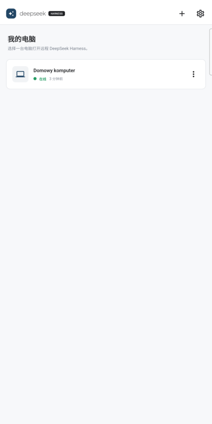

# DSH Remote Mobile

[English](README.md) | [Polski](README.pl.md) | [简体中文](README.zh-CN.md)

> **Projekt społecznościowy:** to nieoficjalny projekt, niezależnie rozwijany i utrzymywany przez społeczność. Nie jest recenzowany, promowany ani wspierany przez DeepSeek.

Mobilny klient Flutter do bezpiecznego otwierania lokalnego DeepSeek Harness na komputerze przez DSH Relay.

<table>
  <tr>
    <td></td>
    <td></td>
  </tr>
</table>

## Zainstaluj aplikację Android

Pobierz podpisany APK z numerem wersji z [najnowszego wydania DSH Mobile Suite](https://github.com/april-jk/dsh-mobile-suite/releases/latest). Na Androidzie zezwól na instalację z przeglądarki lub menedżera plików, gdy pojawi się monit, a następnie otwórz **DSH Remote**.

APK używa identyfikatora aplikacji `io.github.apriljk.dshremote`. Przed instalacją zweryfikuj pobrany plik za pomocą `SHA256SUMS` z tego samego wydania.

## Wymagania

- Flutter 3.38.10 (Dart 3.10)
- iOS 14 lub nowszy
- Android 8.0 (API 26) lub nowszy

## Języki i motyw

Interfejs aplikacji jest dostępny po angielsku, polsku i chińsku uproszczonym. Domyślnie wybiera język systemu telefonu, a dla nieobsługiwanego języka wraca do angielskiego. W Ustawieniach można wybrać język oraz jasny lub ciemny motyw; oba wybory są zapamiętywane między uruchomieniami. Adres e-mail zalogowanego konta jest domyślnie ukryty i pokazuje się tylko na czas bieżącej wizyty po naciśnięciu przycisku oka. Wybór języka nie zmienia konta, parowania ani zapisanych danych logowania. Nazwy komputerów, ścieżki, adresy URL, identyfikatory protokołu i kody błędów nie są tłumaczone.

## Uruchamianie z produkcyjnym Relay

Domyślna kompilacja łączy się z `https://relay.dshmobile.online`:

```bash
flutter run
```

## Uruchamianie z Mock Relay

Tryb Mock musi być włączony jawnie i obsługuje deterministyczne logowanie, parowanie, zarządzanie urządzeniami i stany sesji.

```bash
flutter run --dart-define=DSH_USE_MOCK=true
```

Użyj dowolnego prawidłowego adresu e-mail, hasła mającego co najmniej osiem znaków i dowolnego sześciocyfrowego kodu parowania.

## Przygotuj komputer

Zainstaluj wtyczkę `@april-jk/dsh-mobile` w profilu DSH web, a następnie uruchom DSH:

```bash
npx @deepseek-ai/dsh plugin --profile web add "github:april-jk/dsh-mobile-plugin#v0.1.5"
npx @deepseek-ai/dsh web
```

Companion działa razem z procesem DSH Web. Nie trzeba uruchamiać go jako osobnego procesu w tle.

## Sparuj i otwórz DSH zdalnie

1. Otwórz aplikację mobilną i zarejestruj się lub zaloguj.
2. Na komputerze otwórz **Settings > Remote Access** w DSH i utwórz sześciocyfrowy kod parowania lub kod QR.
3. Na telefonie dotknij **+**, zeskanuj kod QR albo wpisz sześciocyfrowy kod, a następnie wybierz komputer online.
4. W aplikacji otworzy się normalny interfejs DSH Web. Utwórz zadanie i wyślij polecenia tak samo jak na komputerze.

Komputer utrzymuje DSH na `127.0.0.1:3080`; wtyczka nawiązuje wyłącznie wychodzące, szyfrowane połączenie z Relay.

## Uruchamianie z własnym Relay

```bash
flutter run \
  --dart-define=DSH_USE_MOCK=false \
  --dart-define=DSH_RELAY_URL=http://127.0.0.1:8787
```

W emulatorze Androida użyj `http://10.0.2.2:8787`. Urządzenia fizyczne wymagają Relay HTTPS lub nazwy hosta deweloperskiego osiągalnej z urządzenia. Kompilacje produkcyjne muszą używać HTTPS.

Publiczne kompilacje mogą łączyć się z prywatnym Relay bez ponownej kompilacji. Przed logowaniem dotknij przycisku serwera **Relay** albo po zalogowaniu otwórz **Settings > Relay server** i wpisz origin HTTPS serwera Relay. Uruchom komputer z tym samym originem, na przykład `DSH_RELAY=https://relay.example.com npx @deepseek-ai/dsh web`. Zmiana Relay wylogowuje bieżące konto, ponieważ tokeny należą do poprzedniego serwera.

## Weryfikacja

```bash
dart format --output=none --set-exit-if-changed lib test
flutter analyze
flutter test
flutter build apk --debug
flutter build ios --release --no-codesign
```

## Podpisywanie wydania Android

Identyfikator aplikacji Android to `io.github.apriljk.dshremote`. Kompilacje wydania nigdy nie korzystają awaryjnie z certyfikatu Android Debug.

Skopiuj `android/key.properties.example` do ignorowanego pliku `android/key.properties` i wskaż w nim keystore wydania albo podaj w CI następujące zmienne środowiskowe:

- `DSH_ANDROID_STORE_FILE`
- `DSH_ANDROID_STORE_PASSWORD`
- `DSH_ANDROID_KEY_ALIAS`
- `DSH_ANDROID_KEY_PASSWORD`

Następnie zbuduj pakiet Play Store:

```bash
flutter build appbundle --release
```

Przechowuj oryginalny keystore i hasła w trwałym magazynie sekretów. Aktualizacje Androida muszą być podpisane tym samym kluczem.

## Automatyczne wydania

GitHub Actions weryfikuje każdy pull request i każdy push do `main`. Wypchnięcie tagu dokładnie odpowiadającego wersji aplikacji bez sufiksu kompilacji, na przykład `v0.1.5` dla `version: 0.1.5+1005`, uruchamia pełny zestaw testów i publikuje:

- podpisane pliki Android APK i AAB;
- niepodpisane archiwum iOS `.app` do weryfikacji kompilacji, nie do bezpośredniej instalacji;
- `SHA256SUMS` obejmujące każdy zasób wydania.

Przed wypchnięciem tagu wydania skonfiguruj w GitHub Actions następujące sekrety repozytorium:

- `DSH_ANDROID_KEYSTORE_BASE64`: keystore wydania zakodowany w base64;
- `DSH_ANDROID_STORE_PASSWORD`;
- `DSH_ANDROID_KEY_ALIAS`;
- `DSH_ANDROID_KEY_PASSWORD`.

Jeśli brakuje dowolnego sekretu podpisywania, zadanie wydania kończy się niepowodzeniem zamiast utworzyć kompilację Androida. Dystrybucja iOS w App Store pozostaje celowo poza zakresem, dopóki nie zostaną skonfigurowane dane podpisywania Apple i provisioning.

Kody wersji Androida są obliczane jako `MAJOR * 1,000,000 + MINOR * 1,000 + PATCH`. Sufiks kompilacji w `pubspec.yaml` musi być równy tej wartości, aby wydania standalone i Suite pozostawały monotoniczne i wzajemnie wymienne.

## Licencja

[MIT](LICENSE)
